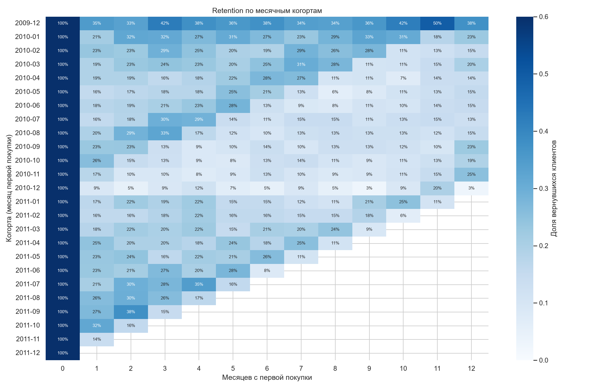
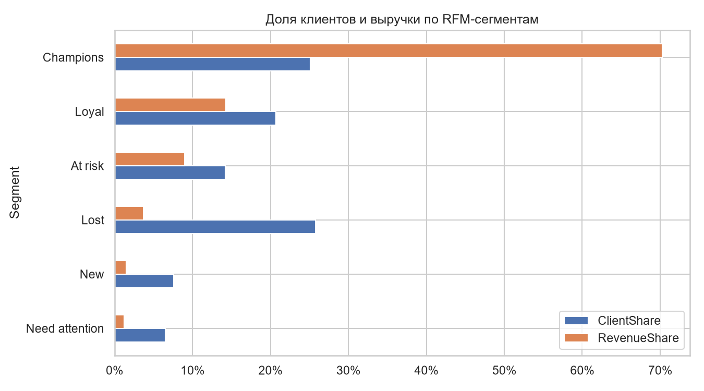
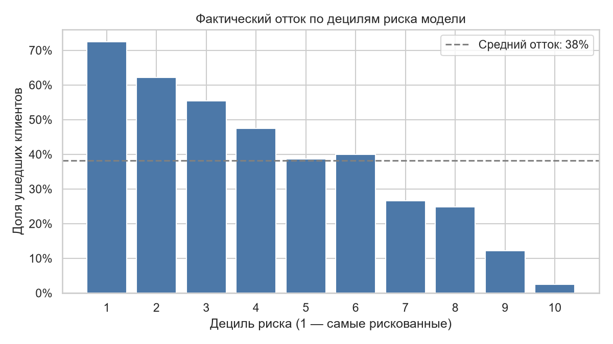
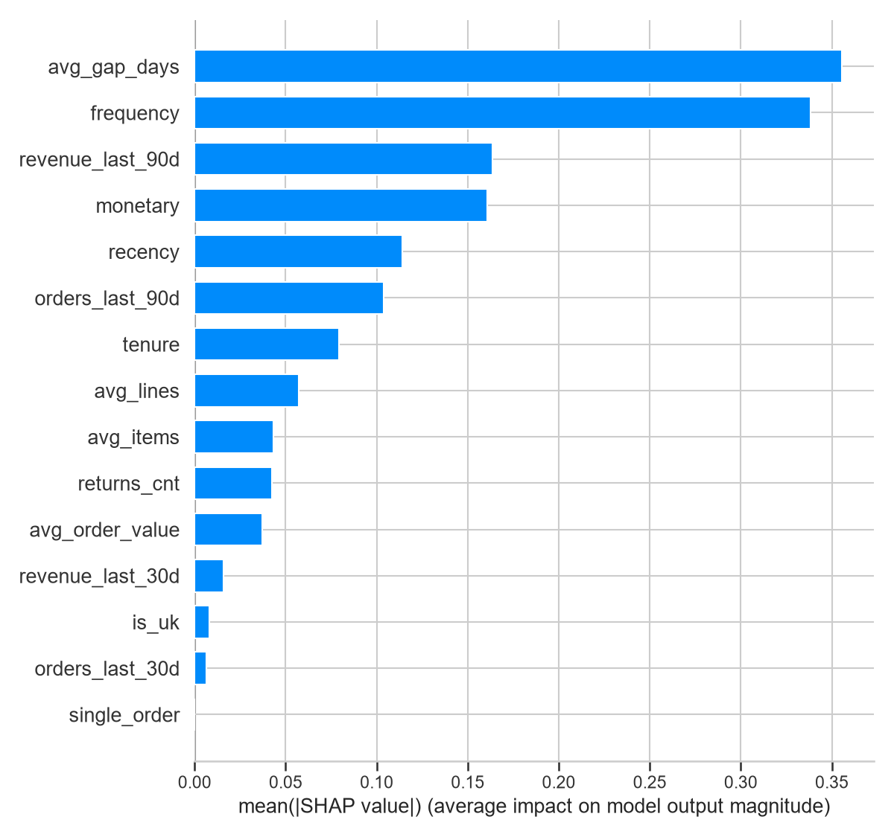
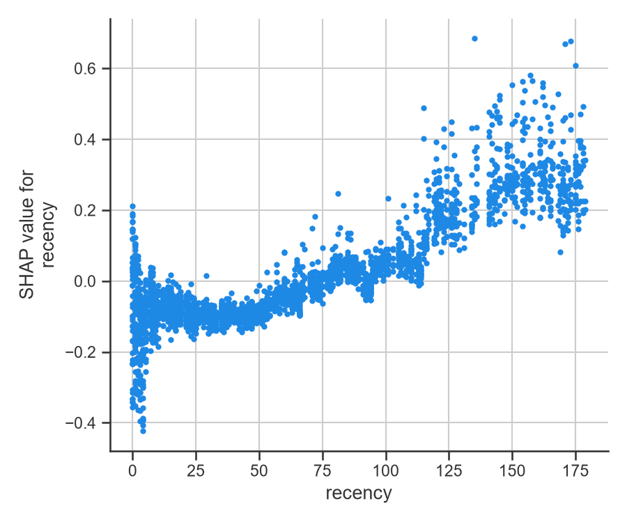

# Анализ клиентов интернет-магазина: когорты, RFM и прогноз оттока

Учебный проект на данных Online Retail II (UCI): транзакции британского интернет-магазина подарков с декабря 2009 по декабрь 2011. Я посмотрела, как клиенты возвращаются, разбила их на сегменты и собрала модель, которая оценивает риск, что клиент не купит ничего в ближайшие 90 дней.

## Данные и очистка

В исходных данных 1 067 371 строка. Я убрала строки без ID клиента (243 тыс.), отмены, строки с нулевой ценой или количеством, служебные коды вроде POST и BANK CHARGES и полные дубликаты. Осталось около 777 тыс. строк, 36 597 заказов и около 5,9 тыс. клиентов.

Отдельно убрала три огромных заказа (до 81 тыс. штук в одной строке), которые отменили через несколько минут после оформления. Они завышали выручку примерно на 1,7%.

## Когорты

Клиенты разбиты на когорты по месяцу первой покупки. В среднем через месяц возвращается 21% клиентов, к десятому месяцу около 15%. К концу года доля вырастает: магазин продаёт подарки и перед Рождеством люди возвращаются.

Когорта декабря 2009 самая большая (951 клиент), потому что в неё попали и те, кто покупал раньше начала данных.

## RFM-сегменты

Клиентов оценила по давности последней покупки, числу заказов и сумме покупок и разделила на шесть сегментов. Самый ценный сегмент Champions это 25% клиентов и 70% выручки. Сегмент Lost больше четверти клиентов, но меньше 4% выручки. Сегмент At risk (14% клиентов, 9% выручки) лучше всего подходит для кампании по возврату: клиенты там покупали часто, но давно.

## Модель оттока

Отток здесь значит, что клиент не купил ничего в течение 90 дней после даты отсечения. Признаки считаются только по прошлым заказам, берутся клиенты, которые покупали за последние 180 дней. Тест это дата 10.09.2011, обучение на пяти более ранних датах. Деление по времени, а не случайное, чтобы не заглядывать в будущее.

Использовала логистическую регрессию и LightGBM. ROC-AUC на тесте около 0,76, простое правило по давности последней покупки даёт 0,66. Если клиентов разбить на десять групп по риску, в самой рискованной уходит 72%, в самой надёжной 2,5% (в среднем 38%). Если связаться с 20% клиентов с самым высоким риском, из них около 67% действительно ушли бы, и мы поймаем 35% всех ушедших.

Заодно проверила модель на клиентах, которых не было в обучении: ROC-AUC 0,74–0,77, примерно как и в основной оценке.

## Что влияет на отток

По SHAP риск растёт, когда у клиента большие интервалы между заказами и мало заказов. Снижают риск заказы и выручка за последние 90 дней и большой срок жизни клиента. После примерно 100 дней без покупки риск заметно растёт. Страна и число возвратов почти ничего не меняют.

Осенью уходит около 38% клиентов, в период с декабря по март до 65%. Поэтому в модели есть месяц даты отсечения, он помогает откалибровать вероятности, но клиентов между собой не различает.

## Что можно из этого сделать

Запускать напоминания примерно через 75–100 дней без покупки, помогать новым клиентам сделать второй заказ и не тратить рассылки на нижние 30% по риску (из них уходит около 12%). Кампании по удержанию лучше планировать после рождественского сезона.

## Ограничения

SHAP показывает связь, но не причину, так что рекомендации стоит проверять A/B-тестом. Окно в 90 дней выбрано мной, для другого бизнеса оно может быть другим. В данных всего два года и один рождественский сезон, а 90% клиентов из Великобритании.

## Запуск

Скачать датасет с [Kaggle](https://www.kaggle.com/datasets/mashlyn/online-retail-ii-uci), положить CSV в `data/raw/`, затем:
python -m venv .venv
.venv\Scripts\activate
pip install -r requirements.txt

Ноутбуки запускать по порядку: eda, cohorts, churn_model.

Стек: Python, pandas, scikit-learn, LightGBM, SHAP, matplotlib, seaborn.